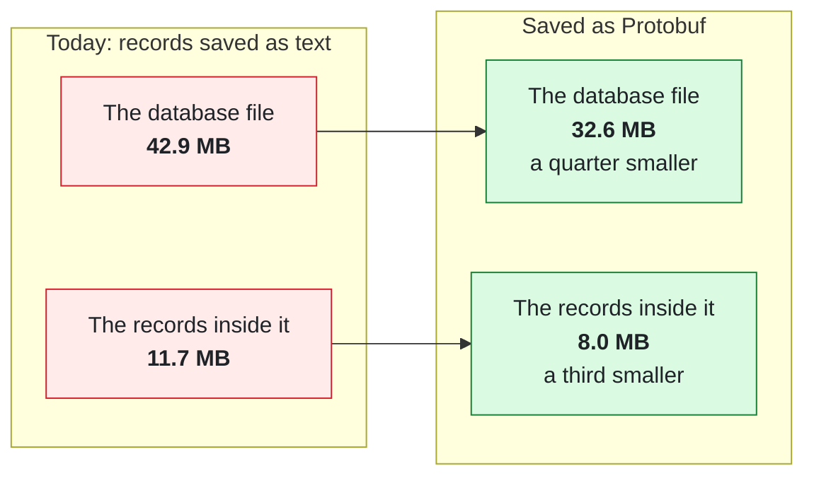

# How much space Protobuf saves

This branch is **not meant to be merged**. It is the storage-format branch plus this page, so the
numbers quoted on the pull request can be checked.

The same 10,000 patient records, written twice: once the way the engine writes them today, once as
Protobuf.



Both databases end up with the same search indexes, 120,000 rows either way, and the same records
come back out. Protobuf is only a cheaper way of writing the same thing down.

## Running it

You need JDK 21. On JDK 25 the Kotlin compiler stops with `IllegalArgumentException: 25.0.4`.

```
./gradlew :engine:desktopTest --tests '*StorageFormatSizeBenchmark' \
  -PbenchmarkResources=10000 --rerun-tasks -i
```

About twenty seconds. Ask for 50,000 records and it takes about ninety and gives the same
percentages. Leave the `-PbenchmarkResources` off and nothing runs, so the normal build and CI are
untouched.

What it prints:

```
resources=10000  seed=20261026

format    db_file_bytes  payload_bytes  bytes_per_resource  index_rows
JSON            42909696       11729168                1172      120000
PROTOBUF        32636928        7994505                 799      120000

db file   -23.9%   (index tables identical in both)
payload   -31.8%   (exact, byte for byte)
```

## How it measures

Both databases get the same records, are closed, reopened and compacted, and are then measured three
ways: the size of the file on disk, the size of the records added up, and the number of rows in each
of the nine index tables. SQLite's `dbstat` is not built into the bundled library, so there is no way
to attribute space to individual tables.

The records are invented from a fixed starting number, `20261026` — patients carrying a narrative,
three identifiers, four extensions, a name, marital status, phone and address, alternating with
observations that point back at them. Nothing to download, and two runs print identical figures. They
go in the way a sync writes them, with nothing waiting to be uploaded.

## Reading the numbers

The saving on the records holds everywhere. The saving on the whole file moves around, because
SQLite stores rows in 4 KB blocks and whether a record just fits or just spills over changes how much
space is wasted around it.

| Where the test records came from | Average record size | The file | The records |
| --- | ---: | ---: | ---: |
| This page, made-up records | 1,172 bytes | -23.9% | -31.8% |
| Real Synthea patient data | 1,747 bytes | -18.9% | -33.3% |
| An earlier, thinner set of made-up records | 776 bytes | -11.4% | -35.2% |

About a third off the records is the figure worth repeating. Any file-size figure should be quoted
together with the data that produced it. Speed came out as run-to-run noise, so nothing here claims
anything is faster.
