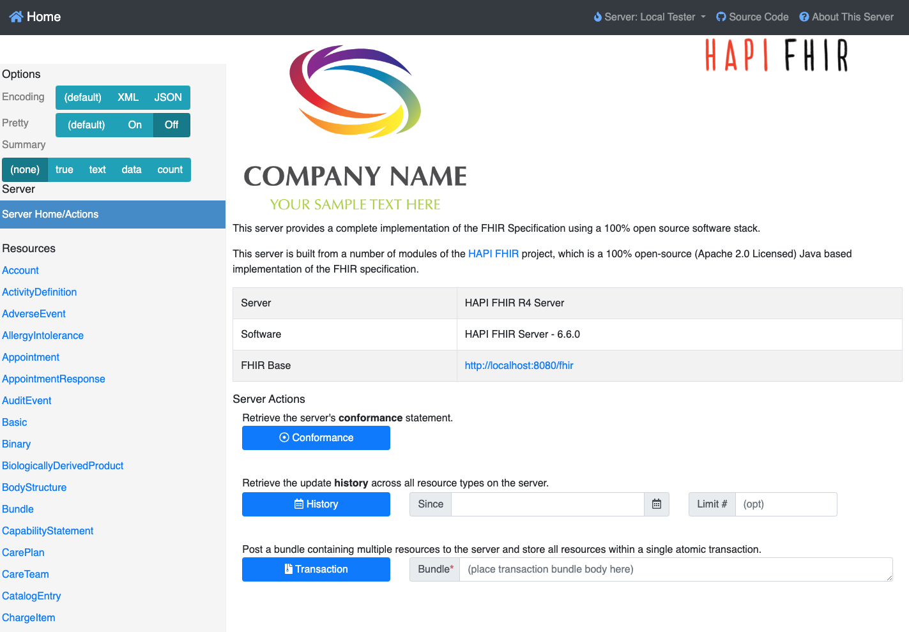
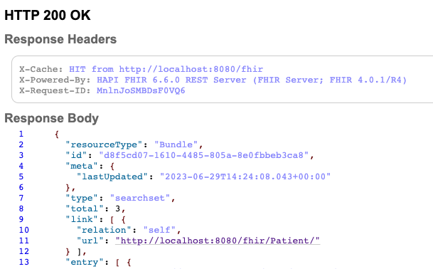

# Manage FHIR resources using the Kotlin FHIR Engine

## Before you begin

### What you'll build

In this codelab, you'll build an Android app with the Kotlin FHIR Engine. The app downloads FHIR
resources from a FHIR server and uploads local changes to the server.

The engine logic and UI are in a Kotlin Multiplatform `shared` module. Only the Android-specific
wiring is in `androidApp`. This codelab targets Android. You can add other platforms later without
changes to `shared/src/commonMain`.

### What you'll learn

*   How to create a local HAPI FHIR server using Docker
*   How to integrate the Kotlin FHIR Engine into a Kotlin Multiplatform project
*   How to use the Sync API to download and upload FHIR resources
*   How to use the Search API
*   How to use the Data Access APIs to create, read, update, and delete FHIR resources locally

### What you'll need

*   Docker ([get Docker](https://docs.docker.com/get-docker/))
*   A recent version of [Android Studio](https://developer.android.com/studio)
*   An [Android Emulator](https://developer.android.com/studio/run/emulator) or a physical device
    running Android 8.0 (API 26) or later
*   JDK 21
*   Basic knowledge of Kotlin and Jetpack Compose

## Set up a local HAPI FHIR server with test data

[HAPI FHIR](https://hapifhir.io/hapi-fhir/) is a popular open source FHIR
server. We use a local HAPI FHIR server in our codelab for the Android app
to connect to.

### Set up the local HAPI FHIR server

1.  Run the following command in a terminal to get the latest image of HAPI FHIR
    ```shell
    docker pull hapiproject/hapi:latest
    ```

1.  Create a HAPI FHIR container by either using Docker Desktop to run the
    previously download image `hapiproject/hapi`, or running the following
    command
    ```shell
    docker run -p 8080:8080 hapiproject/hapi:latest
    ```
    Learn
    [more](https://github.com/hapifhir/hapi-fhir-jpaserver-starter#running-via-docker-hub).

1.  Inspect the server by opening the URL `http://localhost:8080/` in a browser.
    You should see the HAPI FHIR web interface.

    

### Populate the local HAPI FHIR server with test data

To test our application, we'll need some test data on the server. We'll use
synthetic data generated by Synthea.

1.  First, we need to download sample data from
    [synthea-samples](https://github.com/synthetichealth/synthea-sample-data/tree/master/downloads).
    Download and extract `synthea_sample_data_fhir_r4_sep2019.zip`. The
    un-zipped
    sample data has numerous `.json` files, each being a transaction bundle for
    an individual patient.

1.  We'll upload test data for three patients to the local HAPI FHIR server. Run
    the following command in the directory containing JSON files

    ```shell
    curl -X POST -H "Content-Type: application/json" -d @./Aaron697_Brekke496_2fa15bc7-8866-461a-9000-f739e425860a.json http://localhost:8080/fhir/
    curl -X POST -H "Content-Type: application/json" -d @./Aaron697_Stiedemann542_41166989-975d-4d17-b9de-17f94cb3eec1.json http://localhost:8080/fhir/
    curl -X POST -H "Content-Type: application/json" -d @./Abby752_Kuvalis369_2b083021-e93f-4991-bf49-fd4f20060ef8.json http://localhost:8080/fhir/
    ```

1.  To upload test data for all patients to the server, run

    ```shell
    for f in *.json; do curl -X POST -H "Content-Type: application/json" -d @$f http://localhost:8080/fhir/ ; done
    ```

    However, this can take a long time to complete and is not necessary for the
    codelab.

1.  Verify that the test data is available on the server by opening the URL
    `http://localhost:8080/fhir/Patient/` in a browser. You should see the text
    `HTTP 200 OK` and the `Response Body` section of the page containing patient
    data in a FHIR Bundle as the search result with a `total` count.

    

## Set up the project

### Project layout

```
codelabs/
  shared/       Kotlin Multiplatform module
    src/commonMain/   DownloadWorkManagerImpl, PatientListViewModel, PatientListScreen
    src/androidMain/  AppFhirSyncWorker, AndroidSyncLauncher
  androidApp/   FhirApplication, MainActivity
```

### Import the app into Android Studio

Open Android Studio, select **Open**, and choose the `codelabs/` folder.

### The engine dependency

The dependency is in the `commonMain` source set of `shared/build.gradle.kts`:

```kotlin
kotlin {
  sourceSets {
    commonMain.dependencies {
      api("dev.ohs.fhir:fhir-engine:2.0.0-alpha05")
      api("dev.ohs.fhir:fhir-model-r4:1.0.0-rc03")
    }
  }
}
```

The FHIR model is [kotlin-fhir](https://github.com/ohs-foundation/kotlin-fhir), not HAPI.
kotlin-fhir resources are immutable. To change a resource, make a copy with `copy(...)`.

Sync the project with the Gradle files, then run `androidApp` on the emulator.

## Create the FHIR Engine instance

1.  Open `shared/src/commonMain/kotlin/dev/ohs/fhir/codelab/FhirEngineSetup.kt`. `initFhirEngine`
    initializes the engine:

    ```kotlin
    fun initFhirEngine(platformContext: Any, baseUrl: String, debug: Boolean) {
      FhirEngineProvider.init(
        FhirEngineConfiguration(
          databaseErrorStrategy = DatabaseErrorStrategy.RECREATE_AT_OPEN,
          serverConfiguration =
            ServerConfiguration(
              baseUrl = baseUrl,
              httpLogger =
                HttpLogger(if (debug) HttpLogger.Level.BODY else HttpLogger.Level.BASIC),
            ),
        ),
        platformContext,
      )
    }
    ```

    Notes:
    * `platformContext`: the application `Context` on Android, `Unit` on other platforms.
    * `RECREATE_AT_OPEN`: if the database fails to open, the engine deletes it and makes a new one.
    * `enableEncryption = true` encrypts the database with SQLCipher. It is supported on Android
      only.

1.  Call it from `FhirApplication.onCreate()` in `androidApp`:

    ```kotlin
    initFhirEngine(this, baseUrl = "http://10.0.2.2:8080/fhir/", debug = BuildConfig.DEBUG)
    ```

    `10.0.2.2` is the host machine's `localhost` as seen from the Android emulator. Learn
    [more](https://developer.android.com/studio/run/emulator-networking).

1.  Get the engine anywhere with `FhirEngineProvider.getInstance(applicationContext)`.

## Sync data with the FHIR server

1.  `DownloadWorkManagerImpl.kt` in `commonMain` tells the engine which resources to download:

    ```kotlin
    class DownloadWorkManagerImpl : DownloadWorkManager {
      private val urls = ArrayDeque(listOf("Patient"))

      override suspend fun getNextRequest(): DownloadRequest? {
        val url = urls.removeFirstOrNull() ?: return null
        return DownloadRequest.of(url)
      }

      override suspend fun getSummaryRequestUrls() = mapOf<ResourceType, String>()

      override suspend fun processResponse(response: Resource): Collection<Resource> {
        if (response is Bundle && response.type.value == Bundle.BundleType.Searchset) {
          return response.entry.mapNotNull { it.resource }
        }
        return emptyList()
      }
    }
    ```

    The class has a queue of URLs to download. It extracts the resources from each returned bundle,
    and the engine saves them in the local database.

1.  `AppFhirSyncWorker.kt` in `androidMain` is the background worker that runs the sync on Android:

    ```kotlin
    class AppFhirSyncWorker(appContext: Context, workerParams: WorkerParameters) :
      FhirSyncWorker(appContext, workerParams) {

      override fun getDownloadWorkManager() = DownloadWorkManagerImpl()

      override fun getConflictResolver() = AcceptLocalConflictResolver

      override fun getFhirEngine() = FhirEngineProvider.getInstance(applicationContext)

      override fun getUploadStrategy() =
        UploadStrategy.forBundleRequest(
          methodForCreate = HttpCreateMethod.PUT,
          methodForUpdate = HttpUpdateMethod.PATCH,
          squash = true,
          bundleSize = 500,
        )
    }
    ```

1.  Shared code starts a sync through the `SyncLauncher` interface. The Android implementation
    enqueues the worker with WorkManager:

    ```kotlin
    class AndroidSyncLauncher(private val context: Context) : SyncLauncher {
      override suspend fun oneTimeSync() = Sync.oneTimeSync<AppFhirSyncWorker>(context)
    }
    ```

    To add a platform later, implement `SyncLauncher` for it.

1.  In `PatientListViewModel.kt`, `triggerOneTimeSync()` starts the sync and forwards its status to
    the UI:

    ```kotlin
    fun triggerOneTimeSync() {
      scope.launch { syncLauncher.oneTimeSync().collect { _pollState.emit(it) } }
    }
    ```

1.  In `PatientListScreen.kt`, `handleSyncJobStatus` refreshes the list and shows a message when the
    sync completes:

    ```kotlin
    when (syncJobStatus) {
      is CurrentSyncJobStatus.Succeeded -> {
        viewModel.searchPatientsByName("")
        snackbarHostState.showSnackbar("Sync Finished")
      }
      else -> {}
    }
    ```

Run the app and tap **Sync**. The patients from your local FHIR server appear in the list.

## Modify and upload patient data

In this section, you swap the address cities of patients in `Wakefield` and `Taunton`, then upload
the changes. The code is in `triggerUpdate()` in `PatientListViewModel.kt`.

1.  **Search for patients by city.** There are no generated search parameter constants. Use the
    FHIR search parameter name, here `address-city`:

    ```kotlin
    private suspend fun searchByCity(city: String): List<Patient> =
      fhirEngine
        .search<Patient> {
          filter(
            StringClientParam("address-city"),
            {
              modifier = StringFilterModifier.MATCHES_EXACTLY
              value = city
            },
          )
        }
        .map { it.resource }
    ```

1.  **Change the addresses.** kotlin-fhir resources are immutable, so make a copy with the new city:

    ```kotlin
    private fun Patient.withCity(city: String): Patient =
      copy(
        address =
          address.mapIndexed { index, address ->
            if (index == 0) address.copy(city = FhirString(value = city)) else address
          },
      )
    ```

1.  **Update the patients, then sync:**

    ```kotlin
    fun triggerUpdate() {
      scope.launch {
        val patientsFromWakefield = searchByCity("Wakefield")
        val patientsFromTaunton = searchByCity("Taunton")

        patientsFromWakefield.forEach { fhirEngine.update(it.withCity("Taunton")) }
        patientsFromTaunton.forEach { fhirEngine.update(it.withCity("Wakefield")) }

        triggerOneTimeSync()
      }
    }
    ```

### Test the functionality

1.  Run the app and tap **Update**. The cities of patients `Aaron697` and `Abby752` swap.
1.  Open `http://localhost:8080/fhir/Patient/` in a browser. The server has the new cities.

## Search for patients by name

`searchPatientsByName` in `PatientListViewModel.kt` filters patients by name:

```kotlin
fun searchPatientsByName(nameQuery: String) {
  scope.launch {
    val searchResult =
      fhirEngine.search<Patient> {
        if (nameQuery.isNotEmpty()) {
          filter(
            StringClientParam("name"),
            {
              modifier = StringFilterModifier.CONTAINS
              value = nameQuery
            },
          )
        }
      }
    _patients.value = searchResult.map { it.resource }
  }
}
```

If `nameQuery` is not empty, the search returns only the patients whose names contain it. Type a
name, or part of a name, in the search field to filter the list.

## Congratulations!

You have used the Kotlin FHIR Engine to manage FHIR resources in your app:

*   Use the Sync API to sync FHIR resources with a FHIR server
*   Use the Data Access API to create, read, update, and delete local FHIR resources
*   Use the Search API to search local FHIR resources

### Next steps

*   Add a desktop, iOS, or web target to `shared` and implement `SyncLauncher` for it. See
    `engine-app` in this repository for a working example on every platform.
*   Read about [conformance](../docs/conformance.md) and
    [parity with android-fhir](../docs/android-fhir-parity.md).
