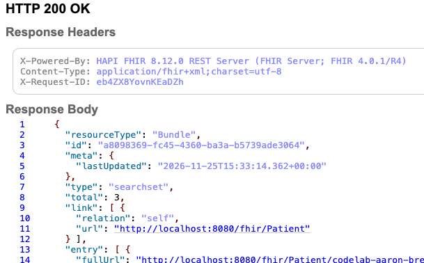
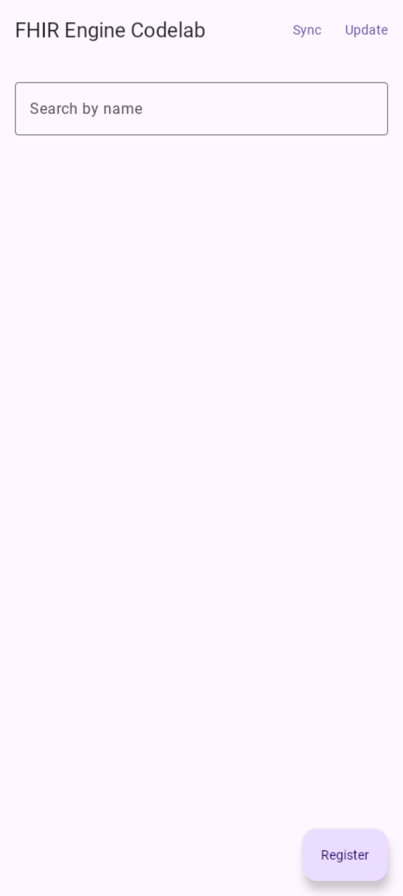
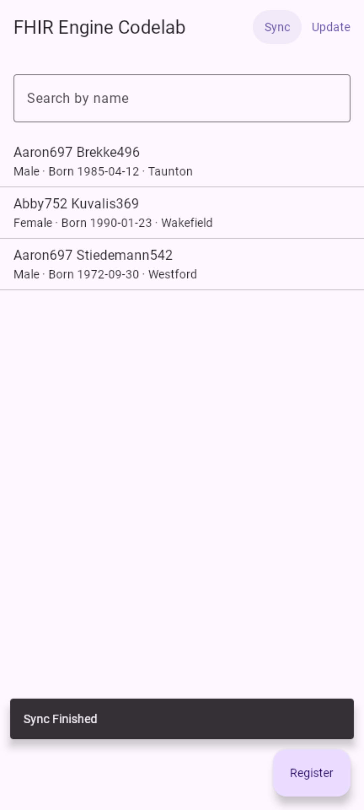
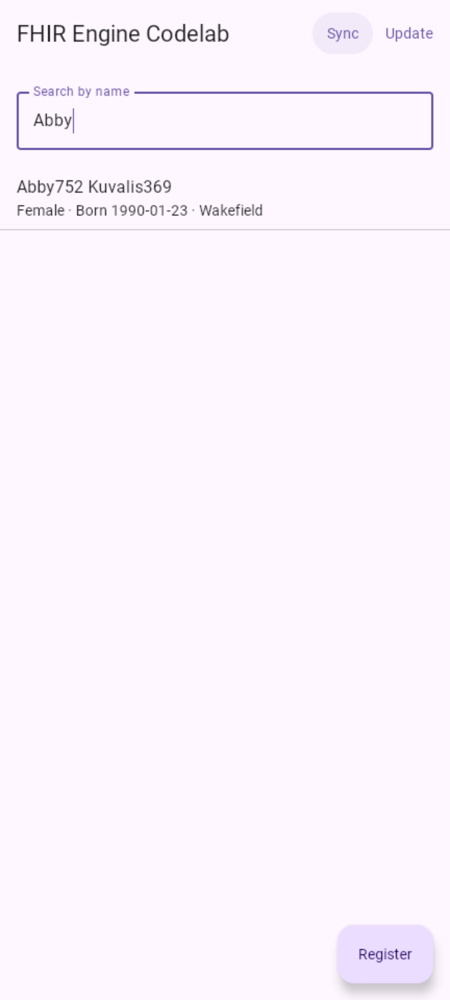
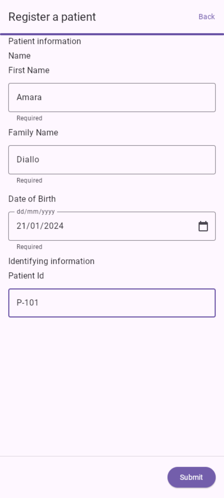
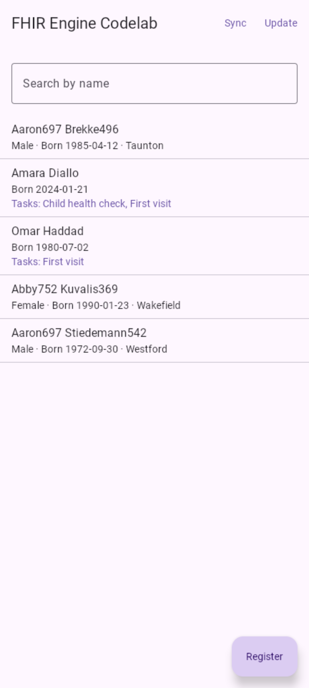

# Manage FHIR resources using the Kotlin FHIR Engine

## 1. Before you begin

### What you'll build

In this codelab, you're going to build a Kotlin Multiplatform app with the Kotlin FHIR Engine. Your
app will use the engine to download FHIR resources from a FHIR server, and upload any local changes
to the server. You'll then add a registration form with Kotlin FHIR Data Capture, and use the Kotlin
FHIR Workflow library to propose the first tasks for each new patient. The same code runs on
Android, iOS, Desktop (JVM) and Web (Wasm).

### What you'll learn

*   How to run a local HAPI FHIR server with Docker
*   How to integrate the Kotlin FHIR Engine into your Kotlin Multiplatform application
*   How to use the Sync API to download and upload FHIR resources
*   How to use the Search API
*   How to use the Data Access APIs to create, read, update, and delete FHIR resources locally
*   How to show a registration form and extract a Patient from it with Kotlin FHIR Data Capture
*   How to apply a PlanDefinition to a patient with the Kotlin FHIR Workflow library

### What you'll need

*   Docker with Docker Compose ([get Docker](https://docs.docker.com/get-docker/))
*   A recent version of [Android Studio](https://developer.android.com/studio)
*   [Android Emulator](https://developer.android.com/studio/run/emulator) or a physical Android
    device running Android 8.0 (API 26) or later
*   JDK 21
*   Optional: a Mac with [Xcode](https://developer.apple.com/xcode/) 26 or later to run the iOS app
*   The sample code
*   Basic knowledge of Kotlin and [Jetpack Compose](https://developer.android.com/compose)

This codelab is focused on the
[Kotlin FHIR Engine](https://github.com/ohs-foundation/kotlin-fhir-engine), with a short look at
[Kotlin FHIR Data Capture](https://github.com/ohs-foundation/kotlin-fhir-data-capture) and
[Kotlin FHIR Workflow](https://github.com/ohs-foundation/kotlin-fhir-workflow) at the end. Non-relevant concepts
and code blocks are glossed over and are provided for you to simply copy and paste. If you haven't
built a Kotlin Multiplatform app before, you can start by
[creating your first Compose Multiplatform app](https://www.jetbrains.com/help/kotlin-multiplatform-dev/compose-multiplatform-create-first-app.html).

## 2. Get the code and start a FHIR server

### Download the code

To download the code for this codelab, you only need the `codelabs` folder of the Kotlin FHIR
Engine repo. You can fetch just that part of the repo with a
[sparse checkout](https://git-scm.com/docs/git-sparse-checkout) (Git 2.25 or later):

```shell
git clone --depth 1 --filter=blob:none --sparse https://github.com/ohs-foundation/kotlin-fhir-engine.git
cd kotlin-fhir-engine
git sparse-checkout set codelabs gradle
```

The `gradle` folder is needed too, because the codelab reads its library versions from
`gradle/libs.versions.toml` at the root of the repo.

Alternatively, you can clone the whole repo:

```shell
git clone https://github.com/ohs-foundation/kotlin-fhir-engine.git
```

The starter project for this codelab is located in `codelabs/`.

### Start a local FHIR server with test data

[HAPI FHIR](https://hapifhir.io/hapi-fhir/) is a popular open source FHIR server. We use a local
HAPI FHIR server in our codelab for the app to connect to.

The `codelabs` folder includes a Docker Compose file that starts a HAPI FHIR server and loads three
test patients into it, together with the PlanDefinition you'll use in step 10. Run the following command in the `codelabs` folder:

```shell
docker compose up -d
```

The first run downloads the HAPI FHIR image, which can take a few minutes. After that, the server
starts in about half a minute. You can carry on with the next step while it starts.

To verify that the test data is available on the server, open the URL
`http://localhost:8080/fhir/Patient` in a browser. You should see a FHIR Bundle as the search
result with a `total` count of 3.



The test data is in the `data` folder. The patients are in `data/patients.json`. To reset the server to them, for example to run the
update step again, run `docker compose down` and then `docker compose up -d`. The app keeps its own
copy of the patients, so tap **Sync** in the app after a reset, before you tap **Update** again.
The server keeps its data in memory, so it starts empty if it restarts, for example after
`docker compose restart` or a restart of Docker. Run `docker compose up -d` again to load the test
data. When you're done with the codelab, stop the server with `docker compose down`.

## 3. Set up the project

### Project structure

| Module       | Contents                                                                                                                                                    |
|:-------------|:------------------------------------------------------------------------------------------------------------------------------------------------------------|
| `shared`     | Kotlin Multiplatform module. `commonMain` holds the engine setup, sync, view model and UI. The other source sets hold each platform's entry point and sync. |
| `androidApp` | Android application. `FhirApplication` initializes the engine and `MainActivity` shows `App()`.                                                             |
| `iosApp`     | Xcode project for iOS. It shows `App()` through `MainViewController()` in `shared/iosMain`.                                                                 |

The platform entry points are already written for you. Everything you'll write in this codelab goes
into seven files in `shared/src/commonMain/kotlin/dev/ohs/fhir/codelab/`:

*   `FhirEngineSetup.kt`
*   `DownloadWorkManagerImpl.kt`
*   `AppFhirSyncTask.kt`
*   `PatientListViewModel.kt`
*   `PatientListScreen.kt`
*   `RegistrationScreen.kt`
*   `EngineWorkflowRepository.kt`

The registration form is in `shared/src/commonMain/composeResources/files/questionnaire.json`.

Each place you'll change is marked with a numbered comment, such as
`// 4 Replace with code from the codelab to initialize the FHIR Engine.` The number tells you which
step of the codelab adds the code.

### Import the app into Android Studio

Let's start by importing the starter app into Android Studio.

Open Android Studio, select **Open** and choose the `codelabs` folder from the source code that you
have downloaded earlier.

### The library dependencies

For your convenience, the Kotlin FHIR Engine, Data Capture and Workflow dependencies have already
been added to the
`commonMain` source set of `shared/build.gradle.kts`:

```kotlin
kotlin {
  sourceSets {
    commonMain.dependencies {
      api("dev.ohs.fhir:fhir-engine:2.0.0-alpha05")
      api("dev.ohs.fhir:fhir-model-r4:1.0.0-rc03")
      implementation("dev.ohs.fhir:fhir-data-capture:2.0.0-alpha05")
      implementation("dev.ohs.fhir:fhir-workflow:2.0.0-alpha01")
      // ...
    }
  }
}
```

Because the dependencies are in `commonMain`, Gradle picks the right artifact for each target
platform.

The FHIR model is [Kotlin FHIR](https://github.com/ohs-foundation/kotlin-fhir), not HAPI. Kotlin
FHIR resources are immutable. To change a resource, make a copy with `copy(...)`.

### Sync your project with Gradle files

To be sure that all dependencies are available to your app, you should sync your project with
Gradle files at this point.

Select **Sync Project with Gradle Files** from the Android Studio toolbar.

### Run the starter app

Now that you have imported the project into Android Studio, you are ready to run the app for the
first time.

Connect your Android device via USB to your host, or
[start the Android Studio emulator](https://developer.android.com/studio/run/emulator). Select the
`androidApp` run configuration and click **Run** in the Android Studio toolbar. You can also
install the app from the command line, in the `codelabs` folder:

```shell
./gradlew :androidApp:installDebug
```

If you run it without opening the project in Android Studio first, set the `ANDROID_HOME`
environment variable to your Android SDK folder.

Because the FHIR Engine is not initialized yet, the app shows a `Hello World!` screen. As you can
see there isn't much here yet, so let's get right into creating the FHIR Engine!


### Run the app on other platforms

Because the app is built with Kotlin Multiplatform, you can run it on other platforms too, at any
step of the codelab. Run the Gradle commands in the `codelabs` folder:

| Platform      | Command or action                                                                  |
|:--------------|:-----------------------------------------------------------------------------------|
| Desktop (JVM) | `./gradlew :shared:run`                                                            |
| Web (Wasm)    | `./gradlew :shared:wasmJsBrowserDevelopmentRun`, which opens `http://localhost:8081` |
| iOS           | Open `iosApp/iosApp.xcodeproj` in Xcode, select a simulator, and click **Run**.    |

The Web dev server doesn't rebuild when you change the code. To see a change, stop it with Ctrl+C
and run the command again. If another app already uses port 8081 on your computer, the browser may
show that app instead. Change the port in `shared/webpack.config.d/dev-server-port.js`.

On iOS, Xcode builds the `shared` framework with Gradle. To run on a real device, see
[`iosApp/README.md`](iosApp/README.md).

## 4. Create the FHIR Engine instance

In this step, you'll initialize the FHIR Engine with the address of your local FHIR server.

Along the way, Android Studio will prompt you to add the necessary imports:

*   `dev.ohs.fhir.engine.DatabaseErrorStrategy`
*   `dev.ohs.fhir.engine.FhirEngineConfiguration`
*   `dev.ohs.fhir.engine.FhirEngineProvider`
*   `dev.ohs.fhir.engine.ServerConfiguration`
*   `dev.ohs.fhir.engine.sync.remote.HttpLogger`

1. Open `shared/src/commonMain/kotlin/dev/ohs/fhir/codelab/FhirEngineSetup.kt`. Find the
    `// 4 Replace with code from the codelab to initialize the FHIR Engine.` comment in
    `initFhirEngine` and replace it with the following code:

    ```kotlin
    // 4 Initialize the FHIR Engine
    FhirEngineProvider.init(
      FhirEngineConfiguration(
        databaseErrorStrategy = DatabaseErrorStrategy.RECREATE_AT_OPEN,
        serverConfiguration =
          ServerConfiguration(
            baseUrl = baseUrl,
            httpLogger =
              HttpLogger(if (debug) HttpLogger.Level.BODY else HttpLogger.Level.BASIC),
          ),
        storageDirectory = storageDirectory,
      ),
      platformContext,
    )
    ```

    Notes:
    * `platformContext`: the application `Context` on Android, `Unit` on other platforms.
    * `baseUrl`: the FHIR server's base URL.
    * `httpLogger`: logs the requests to the server. The logs show up in Logcat on Android, the
      Xcode console on iOS, the terminal on Desktop and the browser console on Web.
    * `storageDirectory`: where the database is stored. Only the Desktop entry point sets it.
    * `RECREATE_AT_OPEN`: if the database fails to open, the engine deletes it and makes a new one.
    * `enableEncryption = true` encrypts the database with SQLCipher. It is supported on Android
      only.

2. Each platform calls `initFhirEngine` once at startup. The starter already has these calls. On
    Android, `FhirApplication.onCreate()` calls it:

    ```kotlin
    initFhirEngine(this, baseUrl = "http://10.0.2.2:8080/fhir/", debug = BuildConfig.DEBUG)
    ```

    `10.0.2.2` is the host machine's `localhost` as seen from the Android emulator. Learn
    [more](https://developer.android.com/studio/run/emulator-networking). The Desktop, Web, and
    iOS entry points call it with `Unit` and `http://localhost:8080/fhir/`.

    On a physical Android device, `10.0.2.2` doesn't reach your computer. Connect the device over
    USB, run `adb reverse tcp:8080 tcp:8080`, and change the `baseUrl` in `FhirApplication` to
    `http://localhost:8080/fhir/`. Run `adb reverse` again whenever you reconnect the device.

3. Get the engine anywhere with `FhirEngineProvider.getInstance(platformContext)`.

Now that the engine is initialized, run the app again. Instead of the `Hello World!` screen, you
should see the patient list. The list stays empty until you sync with the server in the next
step.



## 5. Sync data with the FHIR server

In this step, you'll download patients from the FHIR server into the local database, and upload
local changes back to the server.

Along the way, Android Studio will prompt you to add the necessary imports:

*   `dev.ohs.fhir.model.r4.Bundle`
*   `dev.ohs.fhir.engine.FhirEngineProvider`
*   `dev.ohs.fhir.engine.sync.AcceptLocalConflictResolver`
*   `dev.ohs.fhir.engine.sync.upload.HttpCreateMethod`
*   `dev.ohs.fhir.engine.sync.upload.HttpUpdateMethod`

### Step 1: Define which resources to download

Open `DownloadWorkManagerImpl.kt` in `commonMain`. Replace the two
`// 5.1 Replace with code from the codelab ...` comments, and the `return` lines below them, so that
the class looks like this:

```kotlin
class DownloadWorkManagerImpl : DownloadWorkManager {
  private val urls = ArrayDeque(listOf("Patient"))

  override suspend fun getNextRequest(): DownloadRequest? {
    // 5.1 Return the next download request
    val url = urls.removeFirstOrNull() ?: return null
    return DownloadRequest.of(url)
  }

  override suspend fun getSummaryRequestUrls() = mapOf<ResourceType, String>()

  override suspend fun processResponse(response: Resource): Collection<Resource> {
    // 5.1 Extract the resources from the response
    if (response is Bundle && response.type.value == Bundle.BundleType.Searchset) {
      return response.entry.mapNotNull { it.resource }
    }
    return emptyList()
  }
}
```

This class has a queue of URLs to download. It extracts the resources from each returned bundle,
and the engine saves them in the local database.

### Step 2: Define how the app syncs

Open `AppFhirSyncTask.kt` in `commonMain`. Replace the
`// 5.2 Replace the functions below with code from the codelab to define how the app syncs.`
comment and the four functions below it, so that the class looks like this:

```kotlin
class AppFhirSyncTask(private val platformContext: Any) : FhirSyncTask {
  // 5.2 Define the download manager, conflict resolver, FHIR Engine and upload strategy
  override fun getDownloadWorkManager(): DownloadWorkManager = DownloadWorkManagerImpl()

  override fun getConflictResolver(): ConflictResolver = AcceptLocalConflictResolver

  override fun getFhirEngine(): FhirEngine = FhirEngineProvider.getInstance(platformContext)

  override fun getUploadStrategy(): UploadStrategy =
    UploadStrategy.forBundleRequest(
      methodForCreate = HttpCreateMethod.PUT,
      methodForUpdate = HttpUpdateMethod.PATCH,
      squash = true,
      bundleSize = 500,
    )
}
```

Here, we've defined which download manager, conflict resolver, and FHIR Engine instance to use for
syncing. All platforms use this class.

Shared code starts a sync through the `SyncLauncher` interface. Each platform has its own
implementation, which is already in the starter:

* **Android:** `AndroidSyncLauncher` enqueues `AppFhirSyncWorker` with WorkManager, so the sync
  continues in the background. The worker delegates to `AppFhirSyncTask`.

  ```kotlin
  class AndroidSyncLauncher(private val context: Context) : SyncLauncher {
    override suspend fun oneTimeSync() = Sync.oneTimeSync<AppFhirSyncWorker>(context)
  }
  ```

* **Desktop, Web, and iOS:** `ForegroundSyncLauncher` runs `AppFhirSyncTask` with `runSync` in the
  app's coroutine. The sync stops if the app closes.

### Step 3: Start the sync

Open `PatientListViewModel.kt`. Find the
`// 5.3 Replace with code from the codelab to start the sync.` comment in `triggerOneTimeSync()`
and replace it with the following code:

```kotlin
// 5.3 Start the sync
scope.launch { syncLauncher.oneTimeSync().collect { _pollState.emit(it) } }
```

This coroutine starts a one-time sync with the FHIR server, and forwards the state of the sync to
the UI.

### Step 4: Show when the sync finishes

Open `PatientListScreen.kt`. Find the
`// 5.4 Replace with code from the codelab to show a message when the sync completes.` comment in
`handleSyncJobStatus` and replace it with the following code:

```kotlin
// 5.4 Show a message when the sync completes
when (syncJobStatus) {
  is CurrentSyncJobStatus.Succeeded -> {
    viewModel.refreshPatients()
    snackbarHostState.showSnackbar("Sync Finished")
  }
  is CurrentSyncJobStatus.Failed -> snackbarHostState.showSnackbar("Sync Failed")
  else -> {}
}
```

Here, when the sync finishes, the app reloads the patients from the local database with
`refreshPatients()`, which is already in the starter, and shows a message to the user. If the sync
fails, for example because the FHIR server isn't running, the app shows `Sync Failed`. Check that
`http://localhost:8080/fhir/Patient` opens in your browser, then tap **Sync** again.

Now that everything is set up, run your app and tap **Sync**. If everything works correctly, you
should see the patients from your local FHIR server being downloaded and displayed in the app.



## 6. Modify and upload patient data

In this step, you'll swap the address cities of patients in `Wakefield` and `Taunton`, then upload
the changes to the FHIR server. All the code in this step goes in the `PatientListViewModel` class
in `PatientListViewModel.kt`.

Along the way, Android Studio will prompt you to add the necessary import:

*   `dev.ohs.fhir.engine.search.StringFilterModifier`

You'll also need the Kotlin FHIR `String` type. It has the same name as Kotlin's own `String`, so
add it by hand with an alias:

```kotlin
import dev.ohs.fhir.model.r4.String as FhirString
```

If you import `dev.ohs.fhir.model.r4.String` without the alias, it hides Kotlin's `String` and
parameters such as `city: String` no longer compile.

### Step 1: Search for patients by city

Find the `// 6.1 Replace with code from the codelab to search for patients by city.` comment and
replace it with the following code:

```kotlin
// 6.1 Search for patients by city
private suspend fun searchByCity(city: String): List<Patient> =
  fhirEngine
    .search<Patient> {
      filter(
        StringClientParam("address-city"),
        {
          modifier = StringFilterModifier.MATCHES_EXACTLY
          value = city
        },
      )
    }
    .map { it.resource }
```

There are no generated search parameter constants, so use the FHIR search parameter name, here
`address-city`.

### Step 2: Change the city of a patient

Find the `// 6.2 Replace with code from the codelab to change the city of a patient.` comment and
replace it with the following code:

```kotlin
// 6.2 Change the city of a patient
private fun Patient.withCity(city: String): Patient =
  copy(
    address =
      address.mapIndexed { index, address ->
        if (index == 0) address.copy(city = FhirString(value = city)) else address
      },
  )
```

Kotlin FHIR resources are immutable, so this function makes a copy of the patient with the new
city.

### Step 3: Update the patients, then sync

Find the `// 6.3 Replace with code from the codelab to update the patients and sync.` comment in
`triggerUpdate()` and replace it with the following code:

```kotlin
// 6.3 Update the patients and sync
scope.launch {
  val patientsFromWakefield = searchByCity("Wakefield")
  val patientsFromTaunton = searchByCity("Taunton")

  patientsFromWakefield.forEach { fhirEngine.update(it.withCity("Taunton")) }
  patientsFromTaunton.forEach { fhirEngine.update(it.withCity("Wakefield")) }

  refreshPatients()
  triggerOneTimeSync()
}
```

After modifying the data locally, the app shows the change right away with `refreshPatients()`,
even without a connection. Then it triggers a one-time sync to upload the changes to the FHIR
server.

The code you added to `PatientListViewModel` should now look like this:

```kotlin
fun triggerOneTimeSync() {
  // 5.3 Start the sync
  scope.launch { syncLauncher.oneTimeSync().collect { _pollState.emit(it) } }
}

// 6.1 Search for patients by city
private suspend fun searchByCity(city: String): List<Patient> =
  fhirEngine
    .search<Patient> {
      filter(
        StringClientParam("address-city"),
        {
          modifier = StringFilterModifier.MATCHES_EXACTLY
          value = city
        },
      )
    }
    .map { it.resource }

// 6.2 Change the city of a patient
private fun Patient.withCity(city: String): Patient =
  copy(
    address =
      address.mapIndexed { index, address ->
        if (index == 0) address.copy(city = FhirString(value = city)) else address
      },
  )

/** Swaps the city of patients in Wakefield and Taunton, then syncs the changes. */
fun triggerUpdate() {
  // 6.3 Update the patients and sync
  scope.launch {
    val patientsFromWakefield = searchByCity("Wakefield")
    val patientsFromTaunton = searchByCity("Taunton")

    patientsFromWakefield.forEach { fhirEngine.update(it.withCity("Taunton")) }
    patientsFromTaunton.forEach { fhirEngine.update(it.withCity("Wakefield")) }

    refreshPatients()
    triggerOneTimeSync()
  }
}
```

### Step 4: Test the functionality

1. Run your app. If the list is empty, tap **Sync** first. Then tap **Update**. You should see the
    address cities for `Aaron697 Brekke496` and `Abby752 Kuvalis369` swapped. Each tap of
    **Update** swaps them again.
2. Open `http://localhost:8080/fhir/Patient/` in a browser. Verify that the address cities for
    `Aaron697 Brekke496` and `Abby752 Kuvalis369` are updated on the local FHIR server.

## 7. Search for patients by name

In this step, you'll filter the patient list by the name typed in the search field.

Find the `// 7 Replace with code from the codelab to filter the patients by name.` comment in
`refreshPatients()` and replace it with the following code:

```kotlin
// 7 Filter the patients by name
if (nameQuery.isNotEmpty()) {
  filter(
    StringClientParam("name"),
    {
      modifier = StringFilterModifier.CONTAINS
      value = nameQuery
    },
  )
}
```

Here, if `nameQuery` is not empty, the search returns only the patients whose names contain it. The
starter already stores the text of the search field in `nameQuery` and calls `refreshPatients()`
each time it changes. Each letter you type starts a new search, so `refreshPatients()` cancels the
previous search first. Otherwise an older search, such as the one for the first letter, could
finish last and replace the result. Because the filter is part of `refreshPatients()`, the list
stays filtered after a sync too.

Run your app again. You should now be able to enter a name, or part of a name, in the search field
to filter the list of patients.



## 8. Show a registration form

In this step, you'll add a patient registration form with
[Kotlin FHIR Data Capture](https://github.com/ohs-foundation/kotlin-fhir-data-capture). The form is
a FHIR Questionnaire, and the library renders it for you.

The starter already has what you need around the form:

*   A **Register** button on the patient list, which opens the screen in `RegistrationScreen.kt`
*   The questionnaire in `shared/src/commonMain/composeResources/files/questionnaire.json`, which
    asks for a name, a date of birth and a patient ID. `RegistrationScreen` reads it into
    `questionnaireJson`.
*   The Kotlin FHIR Data Capture dependency in `shared/build.gradle.kts`

Along the way, Android Studio will prompt you to add the necessary imports:

*   `dev.ohs.fhir.datacapture.Questionnaire`
*   `dev.ohs.fhir.datacapture.QuestionnaireConfig`
*   `kotlinx.coroutines.launch`

Open `RegistrationScreen.kt`. Find the
`// 8 Replace with code from the codelab to display the registration form.` comment, delete the
`Text(...)` line below it, and add the following code in its place:

```kotlin
// 8 Display the registration form
questionnaireJson?.let { questionnaireJson ->
  Questionnaire(
    questionnaireJson = questionnaireJson,
    config =
      QuestionnaireConfig(showCancelButton = false, showSubmitAnywayWhenValidationFails = false),
    onSubmit = { getQuestionnaireResponse ->
      scope.launch {
        viewModel.registerPatient(questionnaireJson, getQuestionnaireResponse())
        onClose()
      }
    },
    onCancel = {},
  )
}
```

The `Questionnaire` composable shows the form with a **Submit** button. When you tap **Submit**,
`getQuestionnaireResponse()` checks the answers and returns them as a FHIR QuestionnaireResponse.
The name and date of birth are required. If one is missing or isn't valid, the library lists it
in a dialog and the form stays open. `showSubmitAnywayWhenValidationFails = false` removes the
dialog's option to submit anyway. Otherwise the app
passes the response to `registerPatient()` in the view model and goes back to the patient list.

Run the app and tap **Register**. Fill in the form and tap **Submit**. The app goes back to the
list, but the patient isn't saved yet, because `registerPatient()` is still empty.



To learn more about rendering forms, follow the
[Data Capture codelab](https://github.com/ohs-foundation/kotlin-fhir-data-capture/tree/main/codelabs).

## 9. Save the registered patient

In this step, you'll turn the answers into a FHIR Patient and save it in the local database.
Turning answers into FHIR resources is called
[data extraction](https://hl7.org/fhir/uv/sdc/STU4/extraction.html). The questionnaire contains a
Patient template, and the `TemplateExtractionEngine` class of Kotlin FHIR Data Capture fills it in
with the answers.

Along the way, Android Studio will prompt you to add the necessary imports:

*   `dev.ohs.fhir.datacapture.extraction.template.TemplateExtractionEngine`
*   `dev.ohs.fhir.model.r4.Questionnaire`
*   `kotlinx.serialization.json.Json`

Open `PatientListViewModel.kt`. In `registerPatient()`, find the
`// 9 Replace with code from the codelab to extract and save the patient.` comment and replace it
with the following code:

```kotlin
// 9 Extract and save the patient
val questionnaire = Json.decodeFromString<Questionnaire>(questionnaireJson)
val bundle = TemplateExtractionEngine.extract(questionnaire, questionnaireResponse)
val extracted = bundle.entry.firstNotNullOf { it.resource as? Patient }
val patientId = fhirEngine.create(extracted).first()
val patient = extracted.copy(id = patientId)
```

*   `Json.decodeFromString()` turns the questionnaire JSON into a Kotlin FHIR `Questionnaire`.
*   `TemplateExtractionEngine.extract()` returns a transaction Bundle with the extracted resources.
    For this questionnaire, the Bundle holds one Patient.
*   `fhirEngine.create()` saves the patient in the local database. The extracted patient has no
    ID, so the engine creates one and returns it. You'll use the patient with its ID in step 11.

The starter already runs `registerPatient()` in a coroutine. If the code fails, it shows the error
as a message. When the code finishes, it reloads the patient list.

Run the app and register a patient. The new patient appears in the list. Tap **Sync** to upload
it, then open `http://localhost:8080/fhir/Patient` in a browser to see it on the FHIR server.

## 10. Connect the workflow library to the engine

In the next step, you'll use the
[Kotlin FHIR Workflow](https://github.com/ohs-foundation/kotlin-fhir-workflow) library to apply a
PlanDefinition to each new patient. A PlanDefinition lists actions to take for a patient, and rules
that decide which actions apply. In this step, you'll download the PlanDefinition to the device,
and give the workflow library access to the local database.

The FHIR server already has the PlanDefinition, from `data/registration-plan.json`. It has two
actions, and each points to an ActivityDefinition that describes a Task:

*   **First visit** applies to every new patient.
*   **Child health check** applies only to patients under 5. Its condition is the FHIRPath
    expression `(Patient.birthDate + 5 years) > %today`.

### Step 1: Download the PlanDefinition

Open `DownloadWorkManagerImpl.kt` and change the `urls` line as follows:

```kotlin
// 10.1 Download the PlanDefinition and ActivityDefinitions too
private val urls = ArrayDeque(listOf("Patient", "PlanDefinition", "ActivityDefinition"))
```

The next sync downloads the PlanDefinition and its ActivityDefinitions into the local database,
next to the patients.

### Step 2: Give the workflow library access to the engine

The workflow library reads and writes resources through the `WorkflowRepository` interface. In
this codelab, the resources are in the FHIR Engine, so you'll implement the interface with the
engine.

Along the way, Android Studio will prompt you to add the necessary imports:

*   `dev.ohs.fhir.engine.FhirEngine`
*   `dev.ohs.fhir.engine.db.ResourceNotFoundException`
*   `dev.ohs.fhir.engine.search.ReferenceClientParam`
*   `dev.ohs.fhir.engine.search.Search`
*   `dev.ohs.fhir.engine.search.UriClientParam`
*   `dev.ohs.fhir.model.r4.Resource`
*   `dev.ohs.fhir.model.r4.terminologies.ResourceType`
*   `dev.ohs.fhir.workflow.WorkflowRepository`

Open `EngineWorkflowRepository.kt`. Replace the `// 10.2 Replace with code from the codelab ...`
comment with the following code:

```kotlin
// 10.2 Let the workflow library read and write through the FHIR Engine
class EngineWorkflowRepository(private val fhirEngine: FhirEngine) : WorkflowRepository {
  override suspend fun read(type: String, id: String): Resource? =
    try {
      fhirEngine.get(ResourceType.fromCode(type), id)
    } catch (e: ResourceNotFoundException) {
      null
    }

  override suspend fun create(resource: Resource): String = fhirEngine.create(resource).first()

  override suspend fun update(resource: Resource) = fhirEngine.update(resource)

  override suspend fun delete(type: String, id: String) =
    fhirEngine.delete(ResourceType.fromCode(type), id)

  override suspend fun searchByReferenceParam(
    type: String,
    param: String,
    referenceValue: String,
  ): List<Resource> =
    fhirEngine
      .search<Resource>(
        Search(ResourceType.fromCode(type)).apply {
          filter(ReferenceClientParam(param), { value = referenceValue })
        }
      )
      .map { it.resource }

  override suspend fun searchByUri(type: String, param: String, uri: String): List<Resource> =
    fhirEngine
      .search<Resource>(
        Search(ResourceType.fromCode(type)).apply { filter(UriClientParam(param), { value = uri }) }
      )
      .map { it.resource }
}
```

Each function uses a Data Access or Search API of the engine that you used in the earlier steps.
The workflow library gives the resource type as a string, so these functions build a `Search` for
that type, instead of using `search<Patient> { ... }`. The library finds the PlanDefinition by its
canonical URL with `searchByUri`.

## 11. Propose tasks with the PlanDefinition

In this step, you'll apply the PlanDefinition to each new patient, and save the Tasks it proposes.

Along the way, Android Studio will prompt you to add the necessary imports:

*   `dev.ohs.fhir.model.r4.Date`
*   `dev.ohs.fhir.model.r4.FhirDate`
*   `dev.ohs.fhir.workflow.FhirOperator`
*   `kotlin.time.Clock`
*   `kotlinx.datetime.TimeZone`
*   `kotlinx.datetime.todayIn`

In `registerPatient()` in `PatientListViewModel.kt`, find the
`// 11 Replace with code from the codelab to propose tasks for the patient.` comment and replace it
with the following code:

```kotlin
// 11 Propose tasks for the patient
val today = Clock.System.todayIn(TimeZone.currentSystemDefault())
val carePlan =
  FhirOperator(EngineWorkflowRepository(fhirEngine))
    .generateCarePlan(
      planDefinitionCanonical = REGISTRATION_PLAN,
      subject = patient,
      variables = mapOf("today" to Date(value = FhirDate.fromString(today.toString()))),
      today = today,
    )
val tasks =
  carePlan.contained.filterIsInstance<Task>().map { it.copy(id = null, basedOn = emptyList()) }
fhirEngine.create(*tasks.toTypedArray())
```

*   `FhirOperator` is the entry point of the workflow library. It finds the PlanDefinition by its
    canonical URL, `REGISTRATION_PLAN`, which is already in the starter.
*   `generateCarePlan()` runs
    [`PlanDefinition/$apply`](https://hl7.org/fhir/R4/plandefinition-operation-apply.html) for the
    patient. It checks the condition of each action, and creates a Task with the intent `proposal`
    for each action that applies. It returns the Tasks inside a CarePlan, in `contained`.
*   `variables` makes `%today` available to the conditions. `generateCarePlan()` also takes
    `today`, but this version of the library doesn't pass it to the conditions, so the code passes
    today's date both ways.
*   The Tasks come with IDs from the PlanDefinition actions, which would be the same for every
    patient. Setting `id` to `null` lets the engine create a new ID for each Task. `basedOn` points
    into the CarePlan, which the app doesn't save, so the code removes it.
*   `fhirEngine.create()` saves the Tasks in the local database.

Run the app and tap **Sync**, so that the PlanDefinition is on the device. Then register a child
born less than 5 years ago, and an adult. The date field follows the date format of your device or
browser, such as dd/mm/yyyy or mm/dd/yyyy. Each new patient shows its Tasks in the list. The child
gets First visit and Child health check, and the adult gets only First visit.



Tap **Sync** again to upload the new patients and their Tasks. Open
`http://localhost:8080/fhir/Task` in a browser to see the Tasks on the FHIR server.

If you register a patient before the PlanDefinition is downloaded, the app shows a message that
starts with `Registration failed`. The patient is saved without Tasks. Tap **Sync** before you
register the next patient.

## 12. Congratulations!

You have used the Kotlin FHIR Engine to manage FHIR resources in your app, together with Kotlin
FHIR Data Capture and Kotlin FHIR Workflow:

*   Use the Sync API to sync FHIR resources with a FHIR server
*   Use the Data Access API to create, read, update, and delete local FHIR resources
*   Use the Search API to search local FHIR resources
*   Show a FHIR Questionnaire and extract a Patient from the answers
*   Apply a PlanDefinition to a patient to propose Tasks

### What we've covered

*   How to run a local HAPI FHIR server with test data
*   How to add the Kotlin FHIR Engine to your Kotlin Multiplatform app
*   How to use the Sync API, Data Access API, and Search API of the Kotlin FHIR Engine
*   How to register patients with Kotlin FHIR Data Capture and save them with the engine
*   How to connect Kotlin FHIR Workflow to the engine and run `PlanDefinition/$apply`

### Next steps

*   Run the codelab on the other platforms: Desktop, Web and iOS
*   Download the Tasks too, by adding `Task` to the `urls` queue in `DownloadWorkManagerImpl`, so
    that Tasks created on another device show up
*   Move a proposed Task through its lifecycle with `ActivityFlow` in the
    [Kotlin FHIR Workflow](https://github.com/ohs-foundation/kotlin-fhir-workflow) library
*   Add periodic sync. See [`engine-app`](https://github.com/ohs-foundation/kotlin-fhir-engine/tree/main/engine-app)
    for an example on every platform.
*   Explore the Search API.
    [Search the local store](https://ohs-foundation.github.io/ohs-docs/fhir-foundations/kotlin-fhir-engine/persist-and-search/)
    describes the search parameter types, modifiers and prefixes.
