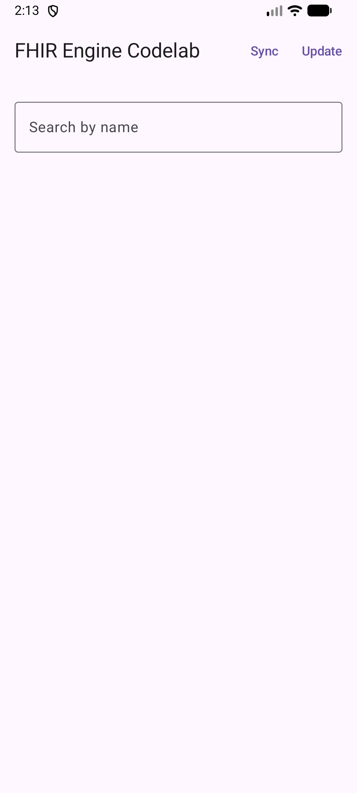
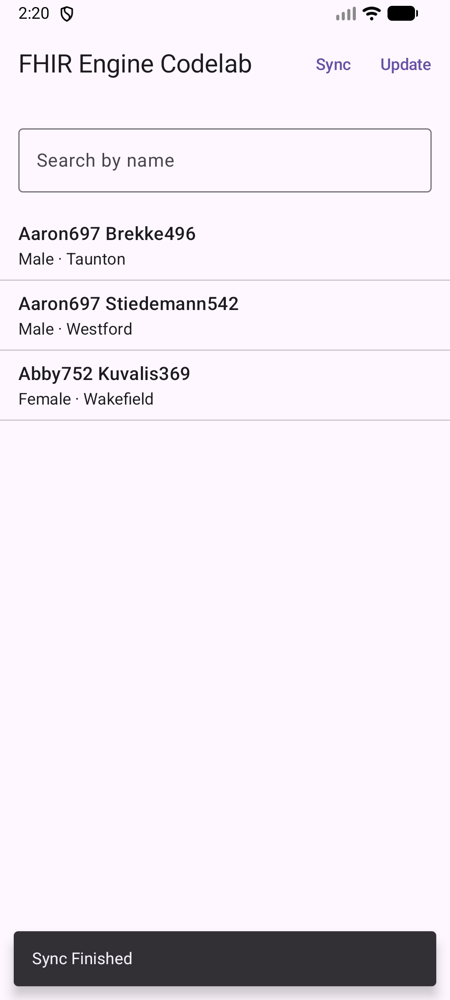

# Manage FHIR resources using the Kotlin FHIR Engine

## 1. Before you begin

### What you'll build

In this codelab, you're going to build a Kotlin Multiplatform app with the Kotlin FHIR Engine. Your
app will use the engine to download FHIR resources from a FHIR server, and upload any local changes
to the server. The same code runs on Android, iOS, Desktop (JVM) and Web (Wasm).

### What you'll learn

*   How to run a local HAPI FHIR server with Docker
*   How to integrate the Kotlin FHIR Engine into your Kotlin Multiplatform application
*   How to use the Sync API to download and upload FHIR resources
*   How to use the Search API
*   How to use the Data Access APIs to create, read, update, and delete FHIR resources locally

### What you'll need

*   Docker with Docker Compose ([get Docker](https://docs.docker.com/get-docker/))
*   A recent version of [Android Studio](https://developer.android.com/studio)
*   [Android Emulator](https://developer.android.com/studio/run/emulator) or a physical Android
    device running Android 8.0 (API 26) or later
*   JDK 21
*   Optional: a Mac with [Xcode](https://developer.apple.com/xcode/) to run the iOS app
*   The sample code
*   Basic knowledge of Kotlin and [Jetpack Compose](https://developer.android.com/compose)

This codelab is focused on the
[Kotlin FHIR Engine](https://github.com/ohs-foundation/kotlin-fhir-engine). Non-relevant concepts
and code blocks are glossed over and are provided for you to simply copy and paste. If you haven't
built a Kotlin Multiplatform app before, you can start by
[creating your first Compose Multiplatform app](https://www.jetbrains.com/help/kotlin-multiplatform-dev/compose-multiplatform-create-first-app.html).

## 2. Get the code and start a FHIR server

### Download the code

To download the code for this codelab, you only need the `codelabs` folder of the Kotlin FHIR
Engine repo. You can fetch just that part of the repo with a
[sparse checkout](https://git-scm.com/docs/git-sparse-checkout) (Git 2.25 or later):

```shell
git clone --depth 1 --filter=blob:none --sparse https://github.com/ohs-foundation/kotlin-fhir-engine.git
cd kotlin-fhir-engine
git sparse-checkout set codelabs gradle
```

The `gradle` folder is needed too, because the codelab reads its library versions from
`gradle/libs.versions.toml` at the root of the repo.

Alternatively, you can clone the whole repo:

```shell
git clone https://github.com/ohs-foundation/kotlin-fhir-engine.git
```

The starter project for this codelab is located in `codelabs/`.

### Start a local FHIR server with test data

[HAPI FHIR](https://hapifhir.io/hapi-fhir/) is a popular open source FHIR server. We use a local
HAPI FHIR server in our codelab for the app to connect to.

The `codelabs` folder includes a Docker Compose file that starts a HAPI FHIR server and loads three
test patients into it. Run the following command in the `codelabs` folder:

```shell
docker compose up -d
```

The first run downloads the HAPI FHIR image, which can take a few minutes. After that, the server
starts in about half a minute. You can carry on with the next step while it starts.

To verify that the test data is available on the server, open the URL
`http://localhost:8080/fhir/Patient` in a browser. You should see a FHIR Bundle as the search
result with a `total` count of 3.


The test patients are in `data/patients.json`. To reset the server to them, for example to run the
update step again, run `docker compose down` and then `docker compose up -d`. When you're done
with the codelab, stop the server with `docker compose down`.

## 3. Set up the project

### Project structure

| Module       | Contents                                                                                                                                                    |
|:-------------|:------------------------------------------------------------------------------------------------------------------------------------------------------------|
| `shared`     | Kotlin Multiplatform module. `commonMain` holds the engine setup, sync, view model and UI. The other source sets hold each platform's entry point and sync. |
| `androidApp` | Android application. `FhirApplication` initializes the engine and `MainActivity` shows `App()`.                                                             |
| `iosApp`     | Xcode project for iOS. It shows `App()` through `MainViewController()` in `shared/iosMain`.                                                                 |

The platform entry points are already written for you. Everything you'll write in this codelab goes
into five files in `shared/src/commonMain/kotlin/dev/ohs/fhir/codelab/`:

*   `FhirEngineSetup.kt`
*   `DownloadWorkManagerImpl.kt`
*   `AppFhirSyncTask.kt`
*   `PatientListViewModel.kt`
*   `PatientListScreen.kt`

Each place you'll change is marked with a numbered comment, such as
`// 4 Replace with code from the codelab to initialize the FHIR Engine.` The number tells you which
step of the codelab adds the code.

### Import the app into Android Studio

Let's start by importing the starter app into Android Studio.

Open Android Studio, select **Open** and choose the `codelabs` folder from the source code that you
have downloaded earlier.

### The Kotlin FHIR Engine dependency

For your convenience, the Kotlin FHIR Engine dependencies have already been added to the
`commonMain` source set of `shared/build.gradle.kts`:

```kotlin
kotlin {
  sourceSets {
    commonMain.dependencies {
      api("dev.ohs.fhir:fhir-engine:2.0.0-alpha05")
      api(libs.fhir.model.r4)
      // ...
    }
  }
}
```

Because the dependencies are in `commonMain`, Gradle picks the right artifact for each target
platform. `libs.fhir.model.r4` comes from the repository's version catalog and resolves to
`dev.ohs.fhir:fhir-model-r4:1.0.0-rc03`.

The FHIR model is [Kotlin FHIR](https://github.com/ohs-foundation/kotlin-fhir), not HAPI. Kotlin
FHIR resources are immutable. To change a resource, make a copy with `copy(...)`.

### Sync your project with Gradle files

To be sure that all dependencies are available to your app, you should sync your project with
Gradle files at this point.

Select **Sync Project with Gradle Files** from the Android Studio toolbar.

### Run the starter app

Now that you have imported the project into Android Studio, you are ready to run the app for the
first time.

Connect your Android device via USB to your host, or
[start the Android Studio emulator](https://developer.android.com/studio/run/emulator). Select the
`androidApp` run configuration and click **Run** in the Android Studio toolbar. You can also
install the app from the command line, in the `codelabs` folder:

```shell
./gradlew :androidApp:installDebug
```

Because the FHIR Engine is not initialized yet, the app shows a `Hello World!` screen. As you can
see there isn't much here yet, so let's get right into creating the FHIR Engine!


### Run the app on other platforms

Because the app is built with Kotlin Multiplatform, you can run it on other platforms too, at any
step of the codelab. Run the Gradle commands in the `codelabs` folder:

| Platform      | Command or action                                                                |
|:--------------|:---------------------------------------------------------------------------------|
| Desktop (JVM) | `./gradlew :shared:run`                                                          |
| Web (Wasm)    | `./gradlew :shared:wasmJsBrowserDevelopmentRun`, then open `http://localhost:8081` |
| iOS           | Open `iosApp/iosApp.xcodeproj` in Xcode, select a simulator, and click **Run**.  |

On iOS, Xcode builds the `shared` framework with Gradle. To run on a real device, see
[`iosApp/README.md`](iosApp/README.md).

## 4. Create the FHIR Engine instance

In this step, you'll initialize the FHIR Engine with the address of your local FHIR server.

Along the way, Android Studio will prompt you to add the necessary imports:

*   `dev.ohs.fhir.engine.DatabaseErrorStrategy`
*   `dev.ohs.fhir.engine.FhirEngineConfiguration`
*   `dev.ohs.fhir.engine.FhirEngineProvider`
*   `dev.ohs.fhir.engine.ServerConfiguration`
*   `dev.ohs.fhir.engine.sync.remote.HttpLogger`

1. Open `shared/src/commonMain/kotlin/dev/ohs/fhir/codelab/FhirEngineSetup.kt`. Find the
    `// 4 Replace with code from the codelab to initialize the FHIR Engine.` comment in
    `initFhirEngine` and replace it with the following code:

    ```kotlin
    // 4 Initialize the FHIR Engine
    FhirEngineProvider.init(
      FhirEngineConfiguration(
        databaseErrorStrategy = DatabaseErrorStrategy.RECREATE_AT_OPEN,
        serverConfiguration =
          ServerConfiguration(
            baseUrl = baseUrl,
            httpLogger =
              HttpLogger(if (debug) HttpLogger.Level.BODY else HttpLogger.Level.BASIC),
          ),
        storageDirectory = storageDirectory,
      ),
      platformContext,
    )
    ```

    Notes:
    * `platformContext`: the application `Context` on Android, `Unit` on other platforms.
    * `baseUrl`: the FHIR server's base URL.
    * `httpLogger`: logs the requests to the server. The logs show up in Logcat on Android, the
      Xcode console on iOS, the terminal on Desktop and the browser console on Web.
    * `storageDirectory`: where the database is stored. Used on desktop and web only.
    * `RECREATE_AT_OPEN`: if the database fails to open, the engine deletes it and makes a new one.
    * `enableEncryption = true` encrypts the database with SQLCipher. It is supported on Android
      only.

2. Each platform calls `initFhirEngine` once at startup. The starter already has these calls. On
    Android, `FhirApplication.onCreate()` calls it:

    ```kotlin
    initFhirEngine(this, baseUrl = "http://10.0.2.2:8080/fhir/", debug = BuildConfig.DEBUG)
    ```

    `10.0.2.2` is the host machine's `localhost` as seen from the Android emulator. Learn
    [more](https://developer.android.com/studio/run/emulator-networking). The Desktop, Web, and
    iOS entry points call it with `Unit` and `http://localhost:8080/fhir/`.

3. Get the engine anywhere with `FhirEngineProvider.getInstance(platformContext)`.

Now that the engine is initialized, run the app again. Instead of the `Hello World!` screen, you
should see the patient list. The list stays empty until you sync with the server in the next
step.



## 5. Sync data with the FHIR server

In this step, you'll download patients from the FHIR server into the local database, and upload
local changes back to the server.

Along the way, Android Studio will prompt you to add the necessary imports:

*   `dev.ohs.fhir.model.r4.Bundle`
*   `dev.ohs.fhir.engine.FhirEngineProvider`
*   `dev.ohs.fhir.engine.sync.AcceptLocalConflictResolver`
*   `dev.ohs.fhir.engine.sync.upload.HttpCreateMethod`
*   `dev.ohs.fhir.engine.sync.upload.HttpUpdateMethod`

### Step 1: Define which resources to download

Open `DownloadWorkManagerImpl.kt` in `commonMain`. Replace the two
`// 5.1 Replace with code from the codelab ...` comments, and the `return` lines below them, so that
the class looks like this:

```kotlin
class DownloadWorkManagerImpl : DownloadWorkManager {
  private val urls = ArrayDeque(listOf("Patient"))

  override suspend fun getNextRequest(): DownloadRequest? {
    // 5.1 Return the next download request
    val url = urls.removeFirstOrNull() ?: return null
    return DownloadRequest.of(url)
  }

  override suspend fun getSummaryRequestUrls() = mapOf<ResourceType, String>()

  override suspend fun processResponse(response: Resource): Collection<Resource> {
    // 5.1 Extract the resources from the response
    if (response is Bundle && response.type.value == Bundle.BundleType.Searchset) {
      return response.entry.mapNotNull { it.resource }
    }
    return emptyList()
  }
}
```

This class has a queue of URLs to download. It extracts the resources from each returned bundle,
and the engine saves them in the local database.

### Step 2: Define how the app syncs

Open `AppFhirSyncTask.kt` in `commonMain`. Replace the
`// 5.2 Replace the functions below with code from the codelab to define how the app syncs.`
comment and the four functions below it, so that the class looks like this:

```kotlin
class AppFhirSyncTask(private val platformContext: Any) : FhirSyncTask {
  // 5.2 Define the download manager, conflict resolver, FHIR Engine and upload strategy
  override fun getDownloadWorkManager(): DownloadWorkManager = DownloadWorkManagerImpl()

  override fun getConflictResolver(): ConflictResolver = AcceptLocalConflictResolver

  override fun getFhirEngine(): FhirEngine = FhirEngineProvider.getInstance(platformContext)

  override fun getUploadStrategy(): UploadStrategy =
    UploadStrategy.forBundleRequest(
      methodForCreate = HttpCreateMethod.PUT,
      methodForUpdate = HttpUpdateMethod.PATCH,
      squash = true,
      bundleSize = 500,
    )
}
```

Here, we've defined which download manager, conflict resolver, and FHIR Engine instance to use for
syncing. All platforms use this class.

Shared code starts a sync through the `SyncLauncher` interface. Each platform has its own
implementation, which is already in the starter:

* **Android:** `AndroidSyncLauncher` enqueues `AppFhirSyncWorker` with WorkManager, so the sync
  continues in the background. The worker delegates to `AppFhirSyncTask`.

  ```kotlin
  class AndroidSyncLauncher(private val context: Context) : SyncLauncher {
    override suspend fun oneTimeSync() = Sync.oneTimeSync<AppFhirSyncWorker>(context)
  }
  ```

* **Desktop, Web, and iOS:** `ForegroundSyncLauncher` runs `AppFhirSyncTask` with `runSync` in the
  app's coroutine. The sync stops if the app closes.

### Step 3: Start the sync

Open `PatientListViewModel.kt`. Find the
`// 5.3 Replace with code from the codelab to start the sync.` comment in `triggerOneTimeSync()`
and replace it with the following code:

```kotlin
// 5.3 Start the sync
scope.launch { syncLauncher.oneTimeSync().collect { _pollState.emit(it) } }
```

This coroutine starts a one-time sync with the FHIR server, and forwards the state of the sync to
the UI.

### Step 4: Show when the sync finishes

Open `PatientListScreen.kt`. Find the
`// 5.4 Replace with code from the codelab to show a message when the sync completes.` comment in
`handleSyncJobStatus` and replace it with the following code:

```kotlin
// 5.4 Show a message when the sync completes
when (syncJobStatus) {
  is CurrentSyncJobStatus.Succeeded -> {
    viewModel.refreshPatients()
    snackbarHostState.showSnackbar("Sync Finished")
  }
  else -> {}
}
```

Here, when the sync finishes, the app reloads all patients from the local database with
`refreshPatients()`, which is already in the starter, and shows a message to the user.

Now that everything is set up, run your app and tap **Sync**. If everything works correctly, you
should see the patients from your local FHIR server being downloaded and displayed in the app.



## 6. Modify and upload patient data

In this step, you'll swap the address cities of patients in `Wakefield` and `Taunton`, then upload
the changes to the FHIR server. All the code in this step goes in the `PatientListViewModel` class
in `PatientListViewModel.kt`.

Along the way, Android Studio will prompt you to add the necessary import:

*   `dev.ohs.fhir.engine.search.StringFilterModifier`

You'll also need the Kotlin FHIR `String` type. It has the same name as Kotlin's own `String`, so
add it by hand with an alias:

```kotlin
import dev.ohs.fhir.model.r4.String as FhirString
```

If you import `dev.ohs.fhir.model.r4.String` without the alias, it hides Kotlin's `String` and
parameters such as `city: String` no longer compile.

### Step 1: Search for patients by city

Find the `// 6.1 Replace with code from the codelab to search for patients by city.` comment and
replace it with the following code:

```kotlin
// 6.1 Search for patients by city
private suspend fun searchByCity(city: String): List<Patient> =
  fhirEngine
    .search<Patient> {
      filter(
        StringClientParam("address-city"),
        {
          modifier = StringFilterModifier.MATCHES_EXACTLY
          value = city
        },
      )
    }
    .map { it.resource }
```

There are no generated search parameter constants, so use the FHIR search parameter name, here
`address-city`.

### Step 2: Change the city of a patient

Find the `// 6.2 Replace with code from the codelab to change the city of a patient.` comment and
replace it with the following code:

```kotlin
// 6.2 Change the city of a patient
private fun Patient.withCity(city: String): Patient =
  copy(
    address =
      address.mapIndexed { index, address ->
        if (index == 0) address.copy(city = FhirString(value = city)) else address
      },
  )
```

Kotlin FHIR resources are immutable, so this function makes a copy of the patient with the new
city.

### Step 3: Update the patients, then sync

Find the `// 6.3 Replace with code from the codelab to update the patients and sync.` comment in
`triggerUpdate()` and replace it with the following code:

```kotlin
// 6.3 Update the patients and sync
scope.launch {
  val patientsFromWakefield = searchByCity("Wakefield")
  val patientsFromTaunton = searchByCity("Taunton")

  patientsFromWakefield.forEach { fhirEngine.update(it.withCity("Taunton")) }
  patientsFromTaunton.forEach { fhirEngine.update(it.withCity("Wakefield")) }

  triggerOneTimeSync()
}
```

After modifying the data locally, the app triggers a one-time sync to upload the changes to the
FHIR server.

Your `PatientListViewModel` class should now look like this:

```kotlin
class PatientListViewModel(
  private val fhirEngine: FhirEngine,
  private val syncLauncher: SyncLauncher,
  private val scope: CoroutineScope,
) {
  private val _pollState = MutableSharedFlow<CurrentSyncJobStatus>()
  val pollState: SharedFlow<CurrentSyncJobStatus> = _pollState

  private val _patients = MutableStateFlow<List<Patient>>(emptyList())
  val patients: StateFlow<List<Patient>> = _patients

  private var loadJob: Job? = null

  init {
    refreshPatients()
  }

  /** Loads all patients from the local database, sorted by given name. */
  fun refreshPatients() = showPatients {
    fhirEngine
      .search<Patient> { sort(StringClientParam("given"), Order.ASCENDING) }
      .map { it.resource }
  }

  /**
   * Shows the patients that [load] returns. Cancels the previous load, so an older search can't
   * replace the result of a newer one.
   */
  private fun showPatients(load: suspend () -> List<Patient>) {
    loadJob?.cancel()
    loadJob = scope.launch { _patients.value = load() }
  }

  fun triggerOneTimeSync() {
    // 5.3 Start the sync
    scope.launch { syncLauncher.oneTimeSync().collect { _pollState.emit(it) } }
  }

  // 6.1 Search for patients by city
  private suspend fun searchByCity(city: String): List<Patient> =
    fhirEngine
      .search<Patient> {
        filter(
          StringClientParam("address-city"),
          {
            modifier = StringFilterModifier.MATCHES_EXACTLY
            value = city
          },
        )
      }
      .map { it.resource }

  // 6.2 Change the city of a patient
  private fun Patient.withCity(city: String): Patient =
    copy(
      address =
        address.mapIndexed { index, address ->
          if (index == 0) address.copy(city = FhirString(value = city)) else address
        },
    )

  /** Swaps the city of patients in Wakefield and Taunton, then syncs the changes. */
  fun triggerUpdate() {
    // 6.3 Update the patients and sync
    scope.launch {
      val patientsFromWakefield = searchByCity("Wakefield")
      val patientsFromTaunton = searchByCity("Taunton")

      patientsFromWakefield.forEach { fhirEngine.update(it.withCity("Taunton")) }
      patientsFromTaunton.forEach { fhirEngine.update(it.withCity("Wakefield")) }

      triggerOneTimeSync()
    }
  }

  fun searchPatientsByName(nameQuery: String) {
    // 7 Replace with code from the codelab to search for patients by name.
  }
}
```

### Step 4: Test the functionality

1. Run your app and tap **Update**. You should see the address cities for patients `Aaron697` and
    `Abby752` swapped.
2. Open `http://localhost:8080/fhir/Patient/` in a browser. Verify that the address cities for
    patients `Aaron697` and `Abby752` are updated on the local FHIR server.

## 7. Search for patients by name

In this step, you'll filter the patient list by the name typed in the search field.

Find the `// 7 Replace with code from the codelab to search for patients by name.` comment in
`searchPatientsByName` and replace it with the following code:

```kotlin
// 7 Search for patients by name
showPatients {
  fhirEngine
    .search<Patient> {
      if (nameQuery.isNotEmpty()) {
        filter(
          StringClientParam("name"),
          {
            modifier = StringFilterModifier.CONTAINS
            value = nameQuery
          },
        )
      }
    }
    .map { it.resource }
}
```

Here, if `nameQuery` is not empty, the search returns only the patients whose names contain it.
`showPatients`, which is already in the starter, shows the result. Each letter you type starts a
new search, so `showPatients` cancels the previous search first. Otherwise an older search, such as
the one for the first letter, could finish last and replace the result.

Run your app again. You should now be able to enter a name, or part of a name, in the search field
to filter the list of patients.


## 8. Congratulations!

You have used the Kotlin FHIR Engine to manage FHIR resources in your app:

*   Use the Sync API to sync FHIR resources with a FHIR server
*   Use the Data Access API to create, read, update, and delete local FHIR resources
*   Use the Search API to search local FHIR resources

### What we've covered

*   How to run a local HAPI FHIR server with test data
*   How to add the Kotlin FHIR Engine to your Kotlin Multiplatform app
*   How to use the Sync API, Data Access API, and Search API of the Kotlin FHIR Engine

### Next steps

*   Run the codelab on the other platforms: Desktop, Web and iOS
*   Download other resource types by adding them to the `urls` queue in `DownloadWorkManagerImpl`
*   Add periodic sync. See [`engine-app`](https://github.com/ohs-foundation/kotlin-fhir-engine/tree/main/engine-app)
    for an example on every platform.
*   Explore the Search API. The [conformance](https://github.com/ohs-foundation/kotlin-fhir-engine/blob/main/docs/conformance.md)
    document lists the supported search parameter types, modifiers and prefixes.
